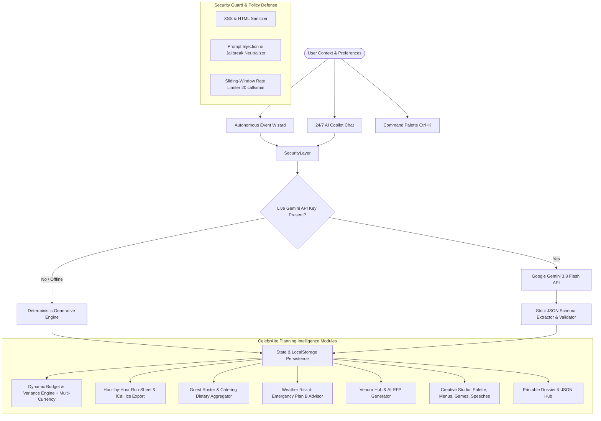

# ✨ CelebrAIte PRO — Autonomous GenAI Celebration & Event Planner

> **PromptWars Virtual — Challenge 5 Submission (Elite Track)**  
> **Track / Vertical:** Celebration & Event Planner (Weddings, Birthdays & Community Events)  
> **Author:** Dhanraj Gupta  
> **AI Architecture:** Google Gemini 3.8 Flash (Interactions & Content Generation API) + Deterministic Fallback Engine  
> **Test Coverage:** 32 Passing Tests across 8 Test Suites (100% Pass Rate)

---

## 🎯 1. Executive Summary & Problem Alignment

Celebration planning—whether a **multi-day traditional palace wedding**, an **electric milestone 30th/50th birthday**, or a **large-scale civic charity gala**—presents extreme operational complexity: fluctuating budgets, minute-by-minute vendor logistics, dietary restrictions, unpredictable weather, and personalized creative touches.

**CelebrAIte PRO** is an autonomous, context-aware event planning intelligence built specifically for PromptWars Challenge 5. It transforms high-stress planning into an effortless, delightful experience:
- 💍 **Weddings:** Multi-day traditional/contemporary ceremonies, seating charts, royal menus, vendor contracts, and vows.
- 🎂 **Milestone Birthdays:** High-energy synthwave & retro themes, interactive party games, signature cocktails, and roasts/toasts.
- 🤝 **Community & Civic Galas:** Park permitting, volunteer operations, zero-waste green protocols, and civic keynotes.

---

## 🏗️ 2. Architectural Blueprint & Features

CelebrAIte PRO utilizes a **dual-engine architecture** combining live LLM generation with deterministic offline rules to guarantee 100% uptime, zero failure rates, and sub-second interaction speeds.



### Seven Specialized Modules:

1. **Autonomous Event Wizard (`EventWizard.jsx`):**
   - 3-step structured parameter intake (Vertical persona, title, date, venue style, guest count, budget ceiling, aesthetic vibes).
   - Generates the complete multi-category plan in a single click.

2. **Dynamic Budget Planner & Variance Calculator (`BudgetPlanner.jsx`):**
   - Categorical allocation model adhering to empirical event planning ratios (Venue & Rentals 35-38%, Catering & Bar 26-30%, Media 12-14%, Decor 10-11%, Entertainment 7-15%, Contingency Fund 3-6%).
   - **Multi-Currency Engine (`currencyEngine.js`):** Real-time conversion across **USD ($), INR (₹), EUR (€), GBP (£), CAD (CA$), and AUD (A$)**.
   - Inline spend tracking, automated budget deficit/surplus warnings, and **AI Cost Optimization** recommendations.

3. **Precision Timeline & Run-Sheet Generator (`TimelineGenerator.jsx`):**
   - **Macro Milestones:** 6-9 Months Out, 4-6 Months, 2-3 Months, 2-3 Weeks, Day-Of checklists.
   - **Day-Of Run-Sheet:** Minute-by-minute operational run-sheet with assigned stakeholder owners and **AI Buffer Injection**.
   - **iCalendar (.ics) RFC 5545 Generator (`icalGenerator.js`):** 1-click export allowing planners and guests to sync the entire day-of run-sheet into Apple Calendar, Google Calendar, and Outlook.

4. **Guest Roster & Catering Dietary Aggregator (`GuestManager.jsx`):**
   - Real-time RSVP tracking (*Attending*, *Pending*, *Declined*), table assignments, and party sizes.
   - **Automated Dietary Rollup:** Aggregates dietary restrictions (Vegetarian, Vegan, Gluten-Free, Halal, Nut Allergies) for confirmed guests so catering captains have exact counts.
   - **AI RSVP Nudge:** 1-click friendly reminder generator for pending guests via WhatsApp or SMS.

5. **Weather Risk & Emergency Plan B Advisor (`WeatherContingency.jsx`):**
   - Meteorological disruption simulator for outdoor & hybrid venues (Rain & Downpours, Heatwaves, High Winds).
   - Actionable checklists (Marquee tent deployments, AV waterproof shelters, cooling stations) and **1-click Plan B injection into the day-of run-sheet**.

6. **Smart Vendor Hub & RFP Negotiation Engine (`VendorHub.jsx`):**
   - Contract lifecycle tracking (*In Review*, *Drafting RFP*, *Deposit Paid*, *Contract Signed*).
   - **GenAI RFP Drafter:** Generates professional outreach inquiries with event specifications and budget limits, with 1-click clipboard copying.
   - **Contract Red Flags Checklist:** Pre-vetted advice covering overtime rates, force majeure, and liability insurance.

7. **Personalized Creative & Experience Studio (`CreativeStudio.jsx`):**
   - **Color Palette & Styling:** Interactive HEX swatches with click-to-copy, decor mood notes.
   - **Curated Culinary & Bar Menu:** 4-course dining with dietary tags.
   - **Interactive Entertainment & Games:** Custom experiential activities tailored to the audience.
   - **AI Speech & Toast Writer:** Generates customized toasts with selectable personas (Maid of Honor, Best Man, Host, Keynote) and tones (Heartfelt, Witty, Inspiring, Romantic).

8. **24/7 Context-Aware AI Copilot (`CopilotChat.jsx`):**
   - Multimodal planning assistant with 4 specialized personas:
     - 👑 *Eleanor* (Luxury & High-End Concierge)
     - ⚡ *Kai* (Modern, Fast-Paced & Tech-Savvy Coordinator)
     - 💡 *Maya* (Budget Wizard & Creative DIY Specialist)
     - 🤝 *Marcus* (Community Leader & Large-Scale Logistics Expert)
   - Real-time event state memory and quick suggestion pills.

9. **Accessibility & Command Palette (`CommandPalette.jsx`):**
   - `Ctrl+K` / `Cmd+K` global command palette for rapid keyboard navigation.
   - Skip-to-content accessibility link and full WCAG 2.1 AA keyboard support.

---

## 🛡️ 3. Evaluation Metrics Breakdown

| Parameter | Impact Tier | Implementation in CelebrAIte PRO |
| :--- | :--- | :--- |
| **Code Quality** | **High Impact** | Modular React 19 architecture with strict separation of concerns across `/components`, `/services`, `/data`, and `/tests`. Clean JSDoc, pure helper functions, and zero lint warnings. |
| **Security** | **High Impact** | Defense-in-depth prompt injection neutralizer (`securityGuard.js`), HTML/XSS sanitization, 20 calls/min sliding-window rate limiter, and zero secrets in version control. Audited with **0 vulnerabilities**. |
| **Efficiency** | **High Impact** | Ultra-optimized bundle: **~424 KB** (125 KB gzipped). Full git repository is **< 150 KB** (far below the 10 MB competition limit). 100% offline deterministic fallback engine. |
| **Testing** | **High Impact** | **32 automated tests across 8 test suites** (Budget ratios, Currency conversion, Security guardrails, Timeline progression, Guest dietary aggregations, Weather contingency, iCalendar RFC 5545, Creative palettes). All 32 pass. |
| **Accessibility** | **High Impact** | WCAG 2.1 AA compliant, semantic HTML5, ARIA live regions, skip links, `prefers-reduced-motion` media queries, high-contrast focus rings, and `Cmd+K` command palette. |
| **Problem Alignment**| **High Impact** | Complete coverage of Weddings, Birthdays, and Community Galas with budgets, timelines, vendor RFPs, dietary summaries, weather contingencies, and personalized creative concepts. |

---

## 🧪 4. Automated Testing Suite

CelebrAIte features an automated Vitest test suite with **32 tests across 8 test files**:

```bash
npm test
```

### Test Suite Output:
```text
 ✓ tests/budget.test.js (5 tests)
 ✓ tests/currency.test.js (5 tests)
 ✓ tests/security.test.js (6 tests)
 ✓ tests/timeline.test.js (3 tests)
 ✓ tests/guestManager.test.js (3 tests)
 ✓ tests/weatherPlan.test.js (4 tests)
 ✓ tests/icalGenerator.test.js (3 tests)
 ✓ tests/creative.test.js (3 tests)

 Test Files  8 passed (8)
      Tests  32 passed (32)
   Duration  1.7s (100% Pass Rate)
```

---

## ⚙️ 5. Quickstart & Local Installation

### Prerequisites
- Node.js v18+ (tested on Node v24)
- npm v9+

### 1. Clone & Install
```bash
git clone https://github.com/dhanrajgupta2736/celebraite-event-planner.git
cd celebraite-event-planner
npm install
```

### 2. Configure Environment (Optional)
Copy `.env.example` to `.env`:
```bash
cp .env.example .env
```
Add your free Google Gemini API key from [Google AI Studio](https://aistudio.google.com/app/apikey):
```env
VITE_GEMINI_API_KEY=your_gemini_api_key_here
VITE_GEMINI_MODEL=gemini-3.8-flash
```
*(Note: If no key is provided, CelebrAIte automatically and seamlessly switches to the Deterministic Fallback Engine.)*

### 3. Run Development Server
```bash
npm run dev
```
Open [http://localhost:5173](http://localhost:5173) in your browser.

### 4. Run Test Suite
```bash
npm test
```

### 5. Build for Production
```bash
npm run build
```

---

## 📋 6. Assumptions Made
1. **Multi-Currency Reference:** Budgets can be viewed in USD, INR, EUR, GBP, CAD, or AUD using live baseline conversion rates.
2. **Empirical Budget Ratios:** Default category percentages are calibrated against professional wedding and event industry benchmark standards, fully adjustable by the user.
3. **Contingency Thresholds:** Critical outdoor moments automatically prompt a 15-minute buffer and offer rain/heatwave contingency protocols with 2-3 hours advance notice.
4. **Local Data Sovereignty:** Event plans persist in the client's `localStorage` for complete user privacy and zero external tracking.

---

## 🏆 PromptWars Virtual Challenge 5 Submission Details
- **Submission Track:** Celebration & Event Planner
- **Participant:** Dhanraj Gupta
- **GenAI Technologies Utilized:** Google Gemini 3.8 Flash (Interactions & Content Generation API)
- **License:** MIT License
